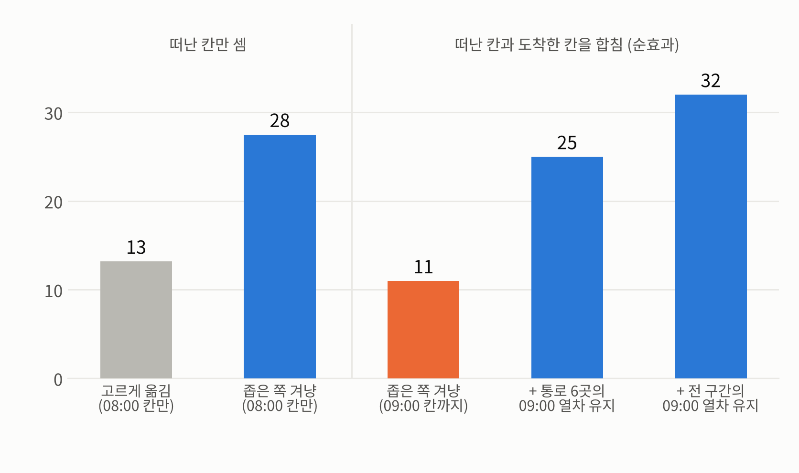

# 150%를 달성한 뒤에 남은 혼잡: 발표 장표

소셜 네트워크 과학 팀 프로젝트(서울 지하철 출근길 병목)의 발표 장표입니다. `index.html` 파일 하나가 장표 30장(본문 16장, 부록 14장)과 발표 대본을 모두 담고 있습니다.

## 보는 법

- 브라우저에서 `index.html`을 연다. (GitHub Pages를 켜면 `https://hyeminhassomething.github.io/subway-bottleneck-deck/` 로 열린다.)
- `←` `→` 이동, `N` 발표자 노트(대본), `F` 전체 화면, 숫자 + Enter 로 그 장으로 이동.
- 주소 끝에 `#7` 을 붙이면 7번 장표로 바로 열린다.

## 파일

| 파일 | 내용 |
|---|---|
| `index.html` | 장표 전체. 스타일, 장표 30장, 대본, 넘김 스크립트 |
| `images/fig01 ~ fig10.png` | 장표에 들어가는 그림 10개 |

## 고치는 법 (사람과 AI 공통)

`index.html`은 세 부분으로 되어 있습니다.

1. `<style>` 안의 **슬라이드 공통 스타일**: 글자 크기, 색, 배치. 여기를 고치면 모든 장표에 적용된다.
2. `<div id="stage">` 안의 **장표들**: `<section id="...">` 하나가 장표 한 장이다. 위에서 아래 순서가 발표 순서다.
3. 맨 아래 `<script>`: 넘김 기능. 고칠 필요 없다.

장표 하나의 모양:

```html
<section id="ch4" data-transition="fade">
<p class="eyebrow">네 번째 발견</p>          <!-- 작은 머리말 -->
<h2>개입은 되돌아온다: ...</h2>               <!-- 제목 -->
<p class="concept">수업 개념: ...</p>          <!-- 수업 개념 한 줄 -->
<div class="cols">
<div class="txt">
<p class="pt">본문 문장</p>
<p class="key">핵심 문장</p>
</div>

</div>
<p class="src">아래 출처 줄</p>
<aside class="notes">발표 대본</aside>        <!-- N 키로 보이는 발표자 노트 -->
</section>
```

### 지켜야 할 것

- 장표는 **1920 × 1080 고정 크기**다. 글을 많이 늘리면 아래가 잘린다. 본문은 지금 분량을 넘기지 않는다.
- `<section>`의 `id`는 서로 달라야 한다.
- 순서를 바꾸거나 지울 때는 `<section> ... </section>` 덩어리를 통째로 옮기거나 지운다.
- **그림 속 숫자는 이미지라서 HTML에서 고칠 수 없다.** 그림을 바꿔야 하면 `images/`의 파일을 같은 이름으로 교체한다.
- **숫자를 바꿀 때는 근거 노트북과 맞는지 확인한다.** 모든 숫자는 팀 드라이브 `06_코드_결과/new_1123_추가_수정/SNS_지하철_병목_전체_1124_v4.ipynb` 의 출력에서 나온다. 장표와 대본에 같은 숫자가 두 번씩 나오므로(본문과 `<aside class="notes">`) 둘 다 고친다.

### AI에게 맡길 때

이 저장소 주소나 `index.html`의 raw 주소를 주고 이렇게 시키면 됩니다.

> 이 index.html에서 `<section id="proposal">` 장표의 카드 문구만 다듬어 줘. 숫자와 다른 장표는 건드리지 말고, 1920×1080 안에 들어가게 분량을 유지해 줘. 고친 뒤 전체 파일을 돌려줘.

고친 파일은 이 저장소에 커밋하거나 Pull Request로 올립니다. 무엇을 왜 고쳤는지 커밋 메시지에 한 줄 적어 주세요.

## 장표 목록

| # | id | 내용 |
|---|---|---|
| 1 | `cover` | 표지: 150%, 질문 셋 |
| 2 | `policy` | 기존 정책의 기준 |
| 3 | `problem` | 문제 정의: 130% 이상 22개 |
| 4 | `net` | 자료와 망, 새 용어 |
| 5 | `degree` | 첫 번째 발견: degree 분포와 가중 degree |
| 6 | `ch2` | 구조 대 통행, null model |
| 7 | `comp` | 두 번째 발견: 컴포넌트 |
| 8 | `ch3` | 세 번째 발견: 병목의 손잡이 |
| 9 | `ch4` | 네 번째 발견: 순효과 |
| 10 | `ch5` | 다섯 번째 발견: 누가 겪는가 |
| 11 | `core` | 통근망에서의 위치 |
| 12 | `ch6a` | 여섯 번째 발견: 증회는 정점만 내렸다 |
| 13 | `ch6b` | 일곱 번째 발견: 시간표 |
| 14 | `proposal` | 제안 |
| 15 | `limits` | 한계와 재현 |
| 16 | `close` | 다시 150% |
| 17 ~ 30 | `appx` 이후 | 부록: 장별 수치 표, 민감도, 탈출 거리, 검증 |

## 자료 출처

서울교통공사 지하철 혼잡도(서울 열린데이터광장 OA-12928, 13개 시점), 서울시 지하철 역간 통행, 서울교통공사 열차운행현황, 서울시 교통분야 누리집의 지하철 혼잡도 완화 대책.
